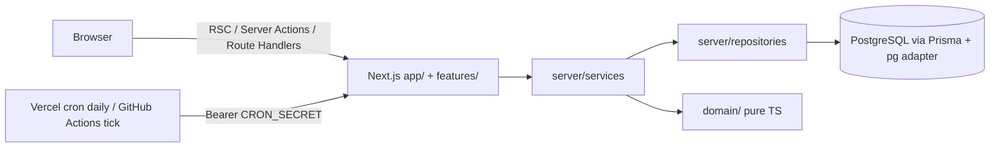

# Architecture

Gearage is a single Next.js (App Router) modular monolith. Rationale: [ADR 0001](adr/0001-modular-monolith.md).

## Layering (enforced by ESLint)

| Layer                              | May import                           | Must not import                                         |
| ---------------------------------- | ------------------------------------ | ------------------------------------------------------- |
| `domain/`                          | itself only                          | next, react, Prisma, pg, `server/`, `features/`, `lib/` |
| `server/`                          | `domain/`, `lib/`, itself            | `features/`, `components/`, `app/`                      |
| `app/`, `features/`, `components/` | `server/services`, `domain/`, `lib/` | `server/repositories`, `server/db`, Prisma              |

## Runtime pieces in M0

- **Env**: `src/lib/env.ts` (Zod) validated at boot by `src/instrumentation.ts`. CI builds set `SKIP_ENV_VALIDATION=1`.
- **DB**: lazy `getDb()` singleton (`@prisma/adapter-pg`, pooled `DATABASE_URL`). Migrations use `DIRECT_URL` via `prisma.config.ts`.
- **API format**: `{ ok: true, data } | { ok: false, error: { code, message, details? } }` via `lib/api-response`; deliberate errors are `AppError`.
- **Health**: `/api/health` (liveness, no deps), `/api/health/ready` (DB ping, 503 when down).
- **Jobs**: `/api/cron/tick` and `/api/cron/daily`, constant-time `CRON_SECRET` check, idempotent job registry ([ADR 0007](adr/0007-background-jobs-and-cron.md)).

## Env strategy

Local: `.env` from `.env.example`. Vercel: Project Settings > Environment Variables (Production / Preview separately). Secrets never use the `NEXT_PUBLIC_` prefix. Supabase: `DATABASE_URL` = pooler (port 6543, `?pgbouncer=true`), `DIRECT_URL` = direct (port 5432).

## Added in M1a

- **Routing**: everything user-facing lives under `src/app/[locale]/` (root layout with `<html lang dir>`); `src/proxy.ts` negotiates the locale. `/api/*` is outside it.
- **Design system**: `src/design/` (tokens, WCAG math) -> generated `src/styles/tokens.css`; fluid type/spacing in `src/styles/globals.css`. See [ADR 0012](adr/0012-design-tokens-theming-and-brand-config.md).
- **Brand**: `src/config/brand.ts` + `public/brand/` ([BRAND.md](BRAND.md)).
- **Settings**: `StoreSetting` (contact/social) read through `server/services/store-settings.service.ts` with safe defaults.
- **DB safety**: `prisma/guard.ts` makes `migrate dev|reset`, `db push|seed|execute` and `studio` refuse non-local hosts.

## Added in M1b (the shell)

- **Chrome** lives in the locale layout: `SiteHeader` (top bar, logo, `search` landmark, account/wishlist/cart, category row), `SiteFooter`, `CookieBanner`. The header is one sticky `<header>`; its top bar scrolls away (negative `top`) and it is static on short landscape phones.
- **Navigation**: `MegaMenu` is the WAI-ARIA disclosure-navigation pattern (buttons with `aria-expanded`, plain-link panels), `MobileNav` is a Radix Dialog + Accordion drawer. Both read one locale-resolved tree (`menu-tree.ts`) built from `features/navigation/categories.ts` (static until M3a).
- **Routes**: `config/routes.ts` is the registry; unbuilt routes render a noindex "coming soon" page through the `[locale]/[...rest]` catch-all, categories through `[locale]/c/[...slug]`.
- **Status**: `domain/status.ts` (coarse states) -> `server/services/status.service.ts` (30s in-memory cache, single-flight, 2.5s timeout) -> `GET /api/status` (always 200, CDN-cacheable) -> footer `StatusDot` (cached poll every 5 min while visible).
- **Consent**: `lib/consent.ts` + `CookieBanner`; first-party `consent` cookie (version, analytics flag, timestamp).
- **Server-side structure** decision: [ADR 0013](adr/0013-server-side-structure.md).

## Added in M2a (catalog and inventory foundations)

- **Domain (pure, unit-tested)**: `money` (piastres, allocation by largest remainder, VAT, formatting), `pricing` (bundle quotes, margin, per-component allocation), `stock` (demand expansion and aggregation, shortages, bundle stock twin), `catalog` (slug, SKU, GTIN, status rules), `specs` (Zod from SpecDefinition rows), `compatibility` (PC build rules reused by bundles and the PC Builder).
- **Data**: `prisma/schema/catalog.prisma` and `inventory.prisma`; migration `20261014000000_catalog_inventory` (hand-written, see [ADR 0014](adr/0014-catalog-schema-and-db-testing.md)); views `product_availability` and `product_pricing`.
- **Server**: `repositories/inventory.repository.ts` (row locking, UTC-safe raw SQL), `services/inventory.service.ts` (reserve, release, expire, convert, COD decrement, restock, adjust), `repositories/catalog.repository.ts` + `services/catalog.service.ts` (bundle detail, storefront listing in one query), `server/storage/` (image storage abstraction), job `expire-stock-reservations`.
- **Tests**: unit tests for every domain module; `npm run test:db` (105 tests incl. concurrency and time zones).
